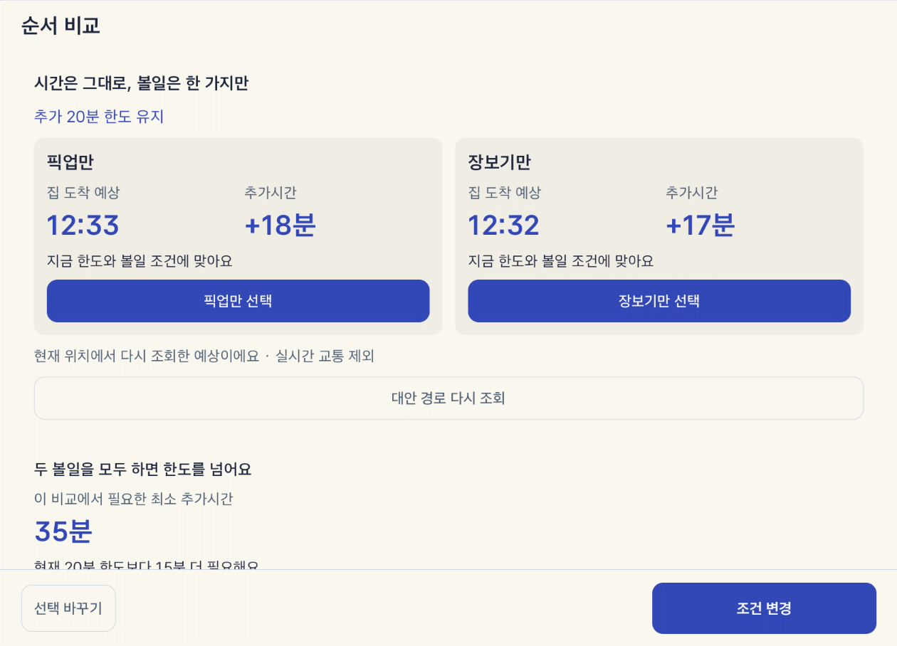
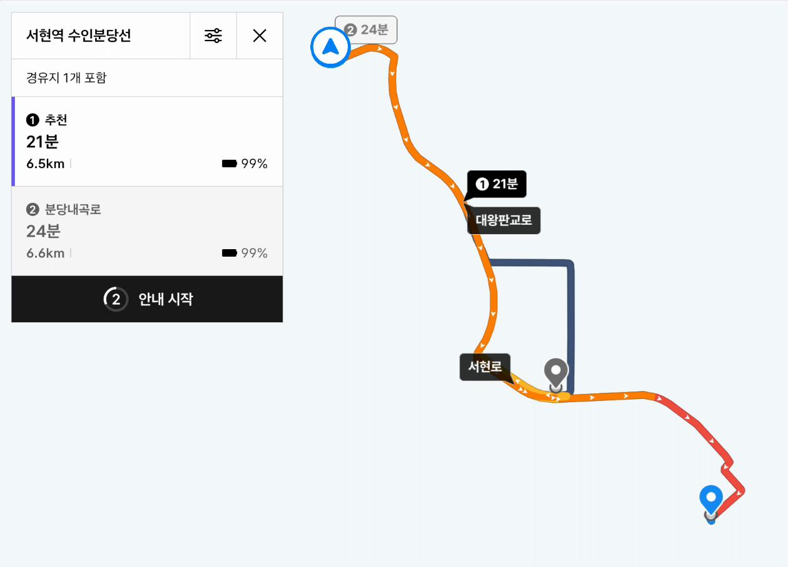
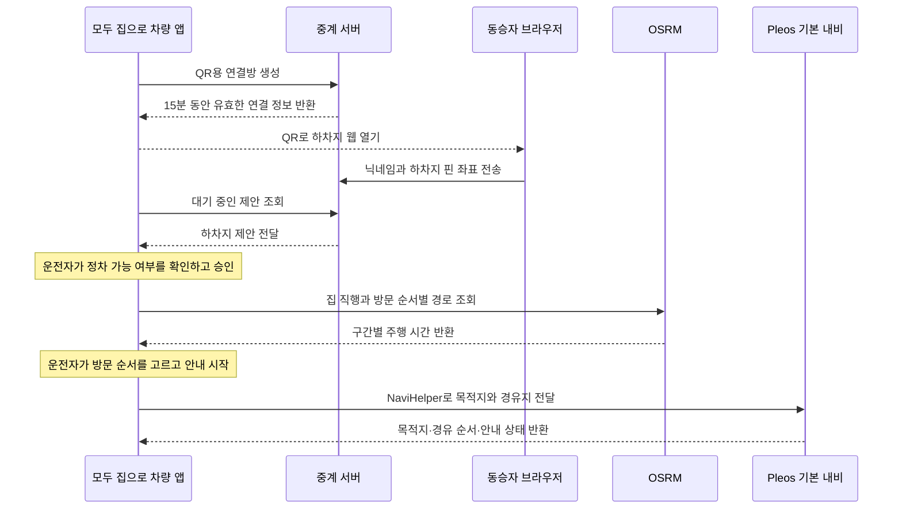

# 모두 집으로

동승자가 QR로 보낸 하차지와 귀갓길의 픽업·장보기를 모아 도착 시각을 비교하고, 고른 순서로 차량 내비를 시작하는 Pleos Connect 앱

**[배포 APK 0.3.1](apk/modu-home_모두집으로_release.apk)** · [시연 순서](#시연-순서) · [동작 구조](#동작-구조) · [개발 환경](#개발-환경)

Pleos Connect Emulator 2.1.0 (API 34) · 2560×1440 px (가로) · 160 dpi

| 기능 | 쓰는 상황 | 사용 흐름 |
| --- | --- | --- |
| **함께 귀가** | 친구를 데려다주는 날 | QR로 하차지 받기 → 사람별 도착 시각 비교 → 차량 내비 시작 |
| **가는김에** | 귀갓길에 픽업이나 장보기가 있는 날 | 추가시간 한도 정하기 → 들를 곳 비교 → 차량 내비 시작 |

## 실제 시연 화면

### 함께 귀가

동승자는 QR을 찍고 브라우저에서 골목 입구처럼 실제로 내릴 곳에 핀을 맞춰 보낸다. 운전자는 정차 가능 여부를 확인하고, 순서를 바꿨을 때 각자의 하차 시각과 집 도착 시각을 비교한다.

<table>
  <thead>
    <tr>
      <th>동승자 웹 · 핀으로 하차지 선택</th>
      <th>차량 · 하차 순서와 도착 시각 비교</th>
    </tr>
  </thead>
  <tbody>
    <tr>
      <td align="center" valign="middle"></td>
      <td align="center" valign="middle"></td>
    </tr>
  </tbody>
</table>

### 가는김에

시연에서 두 곳을 모두 들르는 경로는 집 직행보다 35분이 더 필요했다. 20분 한도 안에서는 **픽업만 +18분**과 **장보기만 +17분**을 비교했다.

<table>
  <thead>
    <tr>
      <th>차량 · 20분 한도 안의 대안 비교</th>
      <th>Pleos 기본 내비 · 픽업 경유지 반영</th>
    </tr>
  </thead>
  <tbody>
    <tr>
      <td align="center"></td>
      <td align="center"></td>
    </tr>
  </tbody>
</table>

## 시연 순서

Pleos AVD에 배포 APK를 설치하고 차량과 휴대폰을 인터넷에 연결한다. 집과 볼일 장소는 기본 내비의 저장 장소나 최근 목적지에서 고른다.

### 함께 귀가

- 차량의 **함께 귀가** 화면에서 **하차지 받기**를 눌러 QR을 표시
- 휴대폰 카메라로 QR을 찍고 브라우저에서 주소를 검색한 뒤, 지도를 확대하고 움직여 가운데 핀에 내릴 곳을 맞춤. **이 위치로 계속**을 눌러 닉네임과 함께 전송
- 차량에서 정차 가능 여부를 확인해 하차지를 승인하고 집을 선택. **방문 순서 비교**에서 도착 시각을 비교한 뒤 **순서 확인 → 내비 시작**

### 가는김에

- 집과 픽업·장보기 장소를 선택하고 **픽업 준비 확인** 후 두 곳의 체류시간을 15분, 허용 추가시간을 20분으로 설정
- **방문 순서 비교**에서 두 곳이 한도를 넘으면 **픽업만·장보기만 비교**로 대안 조회
- **픽업만 선택**으로 집까지의 순서를 확인하고 **내비 시작**
- 정차 후 **픽업 완료**를 눌러 집까지 안내를 이어가고, 귀가하면 **집에 도착했어요**로 완료 기록

## 동작 구조

| 구성 | 역할 |
| --- | --- |
| 차량 앱 | Kotlin·Jetpack Compose로 하차지와 볼일을 승인하고 방문 순서와 도착 시각을 비교. ZXing으로 연결 QR 생성 |
| 동승자 웹 | Photon으로 장소를 검색하고 Leaflet으로 OpenStreetMap을 표시. 가운데 핀의 좌표와 닉네임을 차량에 전송 |
| 운영 HTTPS 서버 | Python 중계가 제안을 잠시 보관하고 차량 수신함으로 전달. OSRM이 후보 순서별 도로 주행 시간 반환 |
| Pleos 기본 내비 | NaviHelper로 선택한 목적지와 경유지를 받아 길안내. 앱이 실제 목적지, 경유 순서, 안내 상태를 조회 |

### QR 하차지 전송과 차량 내비



동승자 두 명과 볼일 한 건을 함께 계획하면 가능한 방문 순서는 여섯 가지다. 도로 주행 시간에 하차 정차와 볼일의 왕복 도보·체류 시간을 더해 비교하며, 화면에는 실시간 교통 제외를 표시한다.

차량 내비에는 현재 안내 구간의 목적지와 경유지를 전달한다. 하차나 볼일 완료를 확인하면 저장해 둔 순서로 다음 구간을 연결한다. 자세한 계산과 완료 처리는 [제품 설계](docs/product.md)와 [차량 내비 연동](docs/vehicle-navigation.md)에 정리했다.

## 개발 환경

| 항목 | 설정 |
| --- | --- |
| Application ID / namespace | `io.moduhome.app` |
| 최소 / 컴파일 / 대상 API | 28 / 37 / 36 |
| JDK | 17 또는 21 |
| Java 바이트코드 | 17 |
| Gradle | 9.4.1 |
| Android Gradle Plugin | 9.2.1 |
| Kotlin / Compose Compiler | 2.4.21 |
| Compose BOM | 2026.09.00 |
| NaviHelper SDK | 3.0.5 |
| SpeechToText SDK | 3.3.1 |
| 차량 실행 환경 | Pleos Connect Emulator 2.1.0 / API 34 |

## 실행

- Android Studio에서 저장소 루트 열기
- Gradle JDK와 Android SDK Platform 37 설정
- 로컬 SDK 경로는 `local.properties`에서 관리
- 차량 연동은 Pleos AVD에서 실행하고 RAM 4GB·Cold boot로 설정
- 디버그 빌드에서 경로 비교와 제안 전송을 시험하려면 [로컬 경로 서버](docs/routing.md)와 [제안 중계](docs/proposal-relay.md#개발-실행)를 실행

```sh
./gradlew :app:assembleDebug
```

APK 경로: `app/build/outputs/apk/debug/app-debug.apk`

출품용 release APK는 서버 주소와 외부 서명 설정을 지정해 [APK 생성](docs/release-package.md) 절차로 내보낸다

```sh
./gradlew :app:testDebugUnitTest :app:lintDebug
```

## 전시 실행

배포 서명 APK는 운영 HTTPS 서버를 사용한다. 업데이트 설치 전 [서명·해시 정보](apk/release.json)에서 설치 파일과 인증서를 대조할 수 있다.

전시용 차량·휴대폰 AVD는 [실행 도구](tools/exhibition/README.md)로 켠다. 각 AVD의 사용자 데이터 파일을 별도로 지정해 재부팅 후에도 장소와 설정을 보관한다. [영상 편집 도구](tools/video/README.md)에서 녹화 구간과 자막을 조정할 수 있다.

## 코드 구조

| 위치 | 담당 |
| --- | --- |
| [ModuHomeApp.kt](app/src/main/kotlin/io/moduhome/app/ModuHomeApp.kt) | 차량과 휴대폰 화면을 연결하고 화면 상태 관리 |
| [core](app/src/main/kotlin/io/moduhome/app/core) | Android와 분리한 순서·시간 계산, 제안 승인, 내비 요청 규칙 |
| [feature](app/src/main/kotlin/io/moduhome/app/feature) | 함께 귀가·가는김에 화면과 승인, 비교, 출발 동작 |
| [data](app/src/main/kotlin/io/moduhome/app/data) | SDK·도로 서버·QR·로컬 저장 어댑터. 내비 요청은 `NavigationGateway`를 통해 연결 |
| [tools/proposal-relay](tools/proposal-relay) | 동승자 웹과 제안 중계 서버 |
| [tools/service-stack](tools/service-stack) | 운영 HTTPS와 도로 경로 서버 실행 구성 |

## 문서

- [제품 설계](docs/product.md)
- [차량 내비 설정과 실행](docs/vehicle-navigation.md)
- [차량 화면 기준](docs/vehicle-ux.md)
- [도로 경로 서버](docs/routing.md)
- [휴대폰과 차량 연결](docs/proposal-relay.md)
- [경로·볼일 제안 HTTPS 서버](tools/service-stack/README.md)
- [출품 APK 생성](docs/release-package.md)
- [작업 규칙](AGENTS.md)
- [공모전 개발 가이드](https://appdevchallenge.auto-hmg.io/guide/development)
- [NaviHelper SDK](https://document.pleos.ai/docs/pleos-only/connect-sdk-pleos/NaviHelper/intro)
