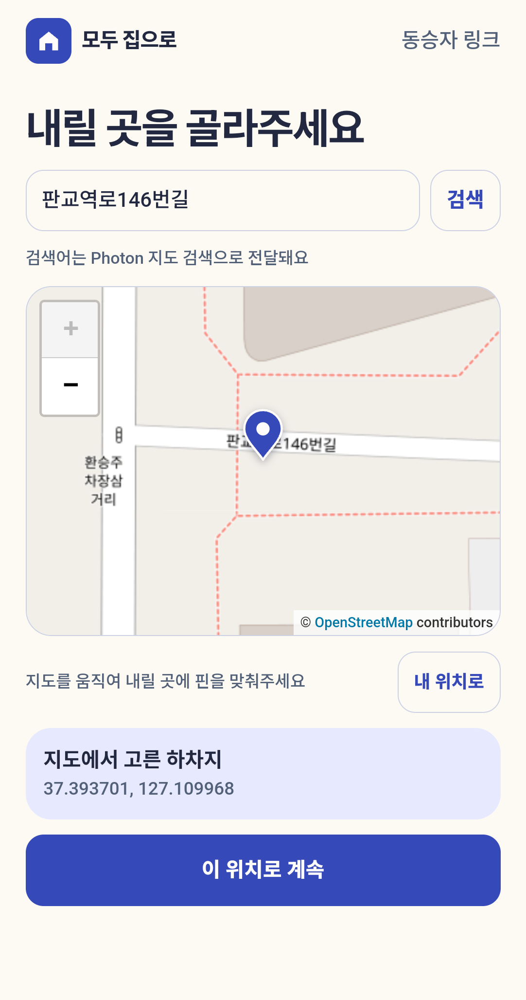
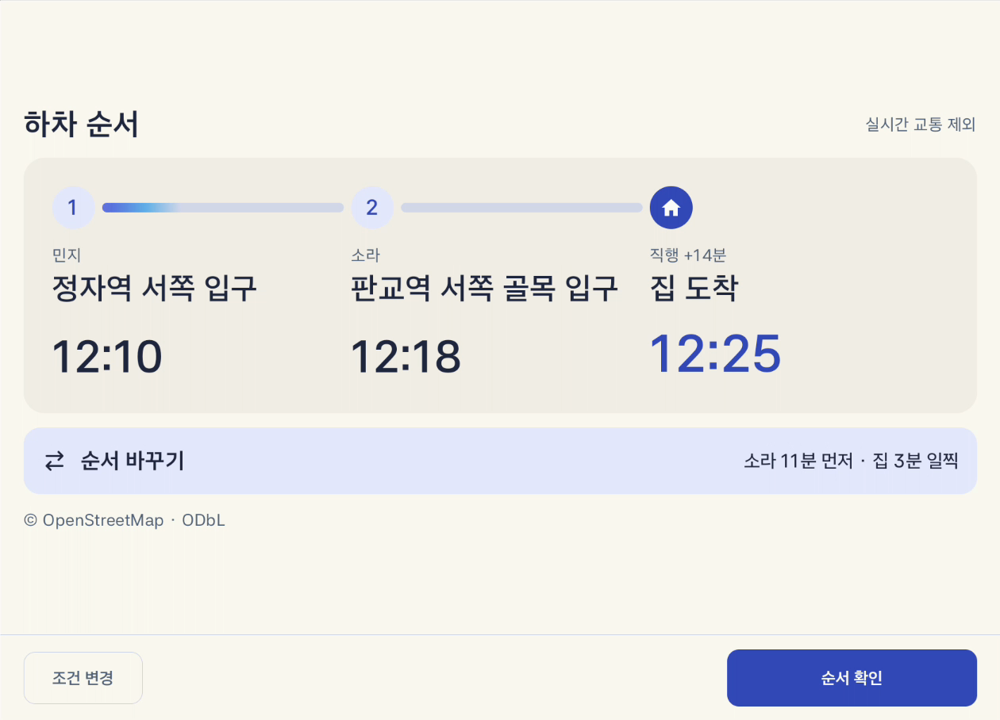
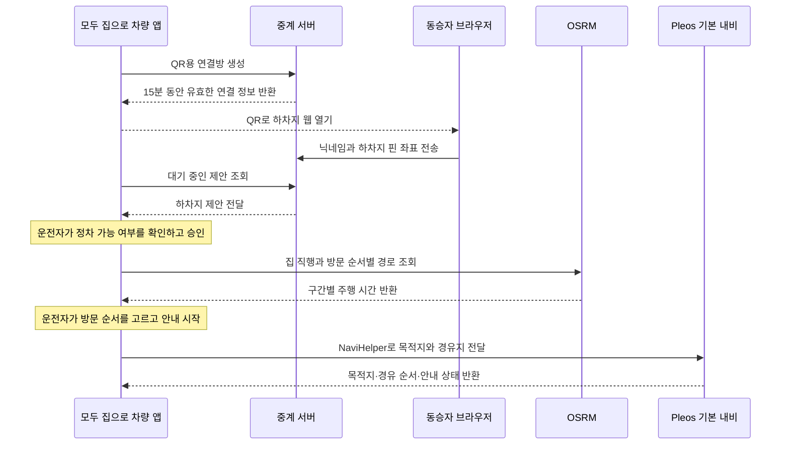

# 모두 집으로

동승자가 QR로 보낸 하차지와 귀갓길의 픽업·장보기를 모아 방문 순서와 도착 시각을 비교하는 Pleos Connect 차량용 앱

**[배포 APK 0.3.1](apk/modu-home_모두집으로_release.apk)** · Pleos Connect Emulator 2.1.0 (API 34) · 2560×1440 px (가로) · 160 dpi

<table>
  <thead>
    <tr>
      <th>동승자 웹 · 핀으로 하차지 선택</th>
      <th>차량 · 하차 순서와 도착 시각 비교</th>
    </tr>
  </thead>
  <tbody>
    <tr>
      <td align="center" valign="middle"></td>
      <td align="center" valign="middle"></td>
    </tr>
  </tbody>
</table>

## 시연 순서

Pleos AVD에 APK를 설치하고 차량과 휴대폰을 인터넷에 연결한다

- 차량의 **함께 귀가** 화면에서 **하차지 받기**를 눌러 QR을 표시
- 휴대폰 카메라로 QR을 찍고 브라우저에서 주소를 검색한 뒤, 지도를 확대하고 움직여 가운데 핀에 내릴 곳을 맞춤. **이 위치로 계속**을 눌러 닉네임과 함께 전송
- 차량에서 정차 가능 여부를 확인해 하차지를 승인하고 집을 선택. **방문 순서 비교**에서 도착 시각을 비교한 뒤 **순서 확인 → 내비 시작**

## QR 하차지 전송과 차량 내비



## 서비스 구성

| 기능 | 목적 |
| --- | --- |
| 함께 귀가 | 동승자가 지정한 하차지와 볼일을 함께 비교하는 귀가 계획 |
| 가는김에 | 돌아가는 길에 픽업·장보기를 더하는 볼일 계획 |

- 함께 귀가는 운전자 1명, 동승자 최대 2명과 볼일 최대 1건으로 구성
- 혼자 가는김에는 픽업·장보기 최대 2건으로 구성
- 집 직행보다 더 걸리는 주행·정차시간과 볼일의 보행·체류시간을 추가시간으로 계산

자세한 사용 흐름과 계산 기준은 [제품 설계](docs/product.md) 참고

## 함께 귀가

- 운전자 집을 차량 내비의 저장 장소·최근 목적지에서 선택
- 동승자 하차지는 저장 장소·최근 목적지에서 선택하거나 휴대폰 제안으로 전달
- 웹 제안은 승인하면 보낸 이름과 함께 빈 동승자 자리에 반영
- 동승자 앱 제안은 대상 동승자와 기존 주소·도착 희망을 확인한 뒤 반영
- 하차지를 승인하기 전에 차량이 접근하고 정차할 수 있는지 운전자가 직접 확인
- 픽업·장보기 중 볼일 1건과 허용 추가시간을 큰 선택 버튼으로 설정
- 받은 볼일의 장소·체류·도보·마감을 확인하고 기존 볼일을 바꾸거나 추가
- 동승자 2명과 볼일 1건이면 여섯 방문 순서를 실제 도로망으로 조회
- 사람별 도착시각·운전자 추가시간·조건 위반 이유를 비교하고 가능한 순서 선택
- 시간 한도만 부족하면 다른 조건을 지키는 최소 추가시간을 선택해 현재 위치에서 다시 비교
- 동승자별 하차 정차 1분을 포함하고 이미 내린 사람의 도착시간은 이후 볼일과 분리
- 동승자 도착시각은 지정한 하차지까지로 계산하고 하차 후 이동은 동승자가 결정
- 전체 계획을 보관하고 남은 정차를 최대 두 곳씩 차량 내비에 반영
- 새 주소는 좌표를 확인할 수 있는 안내 구간으로 연결하고 완료 후 남은 순서와 집으로 안내
- 하차·볼일 완료를 직접 기록하고 재실행 후에는 현재 내비를 다시 확인
- 다음 정차의 차량 내비 시간을 읽어 동승자 도착·볼일 완료 예상과 희망 시각 초과 표시

## 가는김에

- 차량 내비의 저장 장소·최근 목적지에서 집과 들를 곳 선택
- 현재 차량 위치와 도로 경로로 픽업·장보기 순서를 비교하고 집 도착 계획 표시
- 추가시간 한도·마감·수령 준비 여부와 보행·체류시간을 함께 계산
- 모든 순서가 시간 한도를 넘으면 마감·준비 조건을 지키는 최소 추가시간 제안
- 시간 한도를 유지하려면 픽업만·장보기만 하는 경로와 집 도착·추가시간을 새로 조회해 비교
- 대안을 고르면 제외한 볼일의 장소·조건은 보관하고 선택한 볼일만 출발 전 확인
- 큰 글자와 프리셋 버튼으로 체류시간·추가시간 선택
- 선택한 순서를 NaviHelper로 전달하고 내비의 목적지·경유 순서·안내 상태 확인
- 볼일 완료와 집 도착을 따로 기록하고 재실행 시 진행 상태 복원
- QR·링크로 받은 볼일은 내용을 검토한 뒤 같은 종류의 기존 볼일에 반영

두 흐름의 경로 비교는 OpenStreetMap 도로망을 사용하며 실시간 교통은 포함하지 않는다
개발 실행에는 [로컬 경로 서버](docs/routing.md)가 필요하다

## 휴대폰에서 하차지·볼일 보내기

- 하차지 받기 QR을 열고 브라우저에서 하차지 핀과 이름 또는 닉네임을 차량으로 전송
- 차량에서 받은 이름과 하차지를 확인하고 정차할 수 있으면 귀가 계획에 반영
- 내 하차지 보내기에서 주소를 선택하고 이름과 도착 희망을 선택적으로 입력
- 차량의 휴대폰 연결에서 볼일 한 건을 함께 공유할지 고르고 연결 QR 표시
- 휴대폰에서 주소로 새 볼일을 만들거나 받은 볼일의 조건 정해 보내기 선택
- 주소 검색 결과를 고르고 지도 앱에서 위치를 확인한 뒤 픽업·장보기 선택
- 체류·도보·준비·마감 조건을 고친 뒤 보낼 조건 확인
- 하차지·볼일 검토 화면에서 연결된 차량으로 보내고 차량 수신함 보관 상태 확인
- 차량에서 하차지의 정차 가능 여부 또는 볼일 조건을 확인하고 승인한 제안만 계획에 반영
- 보낸 하차지를 수정하면 같은 제안의 새 버전으로 전달하고 차량에서 다시 확인

동승자 앱의 주소 검색은 Android 13 이상에서 기기의 Geocoder를 사용한다
연결은 15분 동안 유지하며 앱이 화면에 열려 있는 동안 제안을 받는다
실행 주소와 저장·승인 경계는 [휴대폰과 차량 연결](docs/proposal-relay.md) 참고

## 개발 환경

| 항목 | 설정 |
| --- | --- |
| Application ID / namespace | `io.moduhome.app` |
| 최소 / 컴파일 / 대상 API | 28 / 37 / 36 |
| JDK | 17 또는 21 |
| Java 바이트코드 | 17 |
| Gradle | 9.4.1 |
| Android Gradle Plugin | 9.2.1 |
| Kotlin / Compose Compiler | 2.4.21 |
| Compose BOM | 2026.09.00 |
| NaviHelper SDK | 3.0.5 |
| SpeechToText SDK | 3.3.1 |
| 차량 실행 환경 | Pleos Connect Emulator 2.1.0 / API 34 |

## 실행

- Android Studio에서 저장소 루트 열기
- Gradle JDK와 Android SDK Platform 37 설정
- 로컬 SDK 경로는 `local.properties`에서 관리
- 차량 연동은 Pleos AVD에서 실행하고 RAM 4GB·Cold boot로 설정

```sh
./gradlew :app:assembleDebug
```

APK 경로: `app/build/outputs/apk/debug/app-debug.apk`

출품용 release APK는 서버 주소와 외부 서명 설정을 지정해 [APK 생성](docs/release-package.md) 절차로 내보낸다

```sh
./gradlew :app:testDebugUnitTest :app:lintDebug
```

## 제출용 APK와 전시 실행

배포 서명 APK 0.3.1은 [apk 폴더](apk/modu-home_모두집으로_release.apk)에 둔다
[서명·해시 정보](apk/release.json)에서 설치 파일과 인증서를 대조할 수 있다
운영 HTTPS 서버를 사용하며 같은 서명으로 업데이트 설치한다

전시용 차량·휴대폰 AVD는 [실행 도구](tools/exhibition/README.md)로 켠다
각 AVD의 사용자 데이터 파일을 별도로 지정해 재부팅 후에도 장소와 설정을 보관한다
시연 영상은 [편집 도구](tools/video/README.md)에서 녹화 구간과 자막을 조정하고 배포 APK의 버전으로 만든다

## 코드 구조

```text
app/src/main/kotlin/io/moduhome/app/
├── MainActivity.kt
├── ModuHomeApp.kt
├── core/
│   ├── address/        # 주소 후보 검증과 검색 취소·중복 요청 제어
│   ├── planning/       # 주행·보행·체류 시간 계산
│   ├── shared/         # 동승자 하차와 볼일 순서 계산
│   ├── navigation/     # 목적지와 내비 요청 계약
│   ├── routing/        # 도로 경로 응답 검증
│   ├── transfer/       # 하차지·볼일 제안과 승인 규칙
│   ├── vehicle/        # 차량 화면 제한
│   └── voice/          # 음성 입력 계약과 명령 해석
├── data/               # SDK·도로 서버·QR·로컬 저장 어댑터
├── feature/
│   ├── home/           # 계획 상태와 상세 입력
│   ├── shared/         # 함께 귀가 입력·경로 조회·단계별 안내
│   ├── vehicle/        # 차량 전용 화면과 큰 선택창
│   └── transfer/       # 휴대폰 제안 화면
└── ui/theme/            # 차량·휴대폰 글자 크기와 색상
```

- `ModuHomeApp`에서 화면 상태를 소유하고 각 화면에 값과 콜백 전달
- `feature/shared`에서 함께 귀가의 조회·저장·내비 작업을 조정하고 차량 화면은 상태를 표시
- 시간과 순서 계산은 Android와 분리해 `core/planning`·`core/shared`에서 처리
- 내비 요청은 `NavigationGateway`를 통해 화면과 SDK 사이를 분리
- `data/navigation`에서 SDK 초기화·해제와 목적지·경유지 변환 처리
- `data/shared`에서 입력·도로 응답·선택 순서·완료·제안 수락 기록을 저장하고 복원 시 다시 검증

## 문서

- [제품 설계](docs/product.md)
- [차량 내비 설정과 실행](docs/vehicle-navigation.md)
- [차량 화면 기준](docs/vehicle-ux.md)
- [도로 경로 서버](docs/routing.md)
- [휴대폰과 차량 연결](docs/proposal-relay.md)
- [경로·볼일 제안 HTTPS 서버](tools/service-stack/README.md)
- [출품 APK 생성](docs/release-package.md)
- [작업 규칙](AGENTS.md)
- [공모전 개발 가이드](https://appdevchallenge.auto-hmg.io/guide/development)
- [NaviHelper SDK](https://document.pleos.ai/docs/pleos-only/connect-sdk-pleos/NaviHelper/intro)
